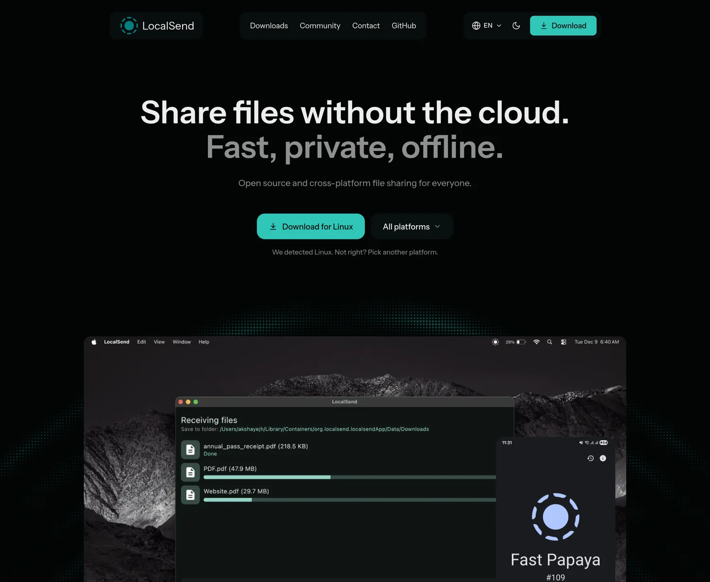
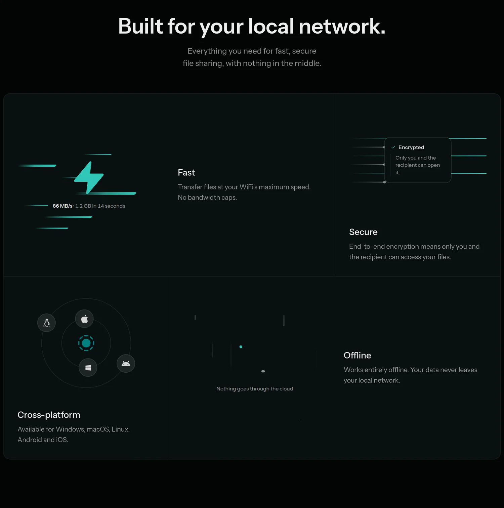
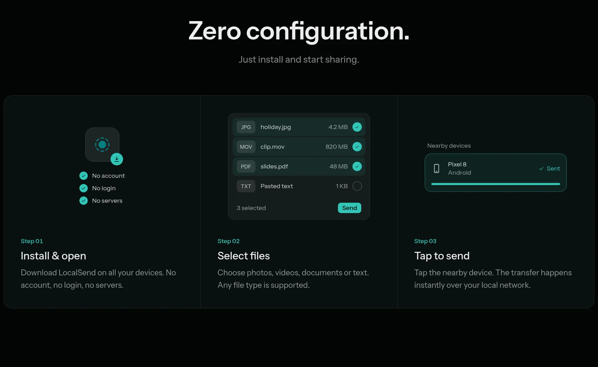
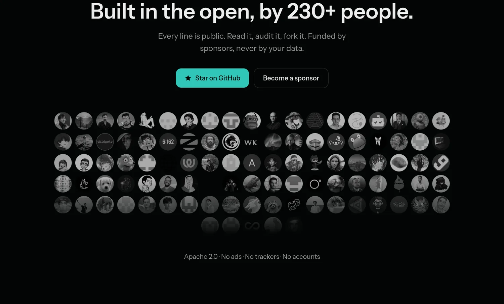
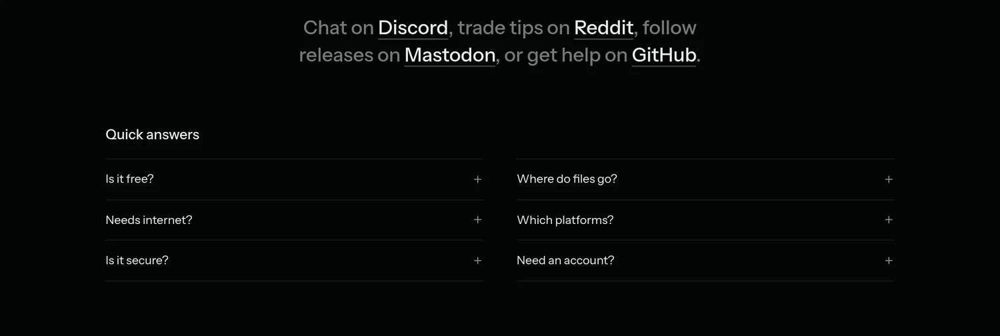
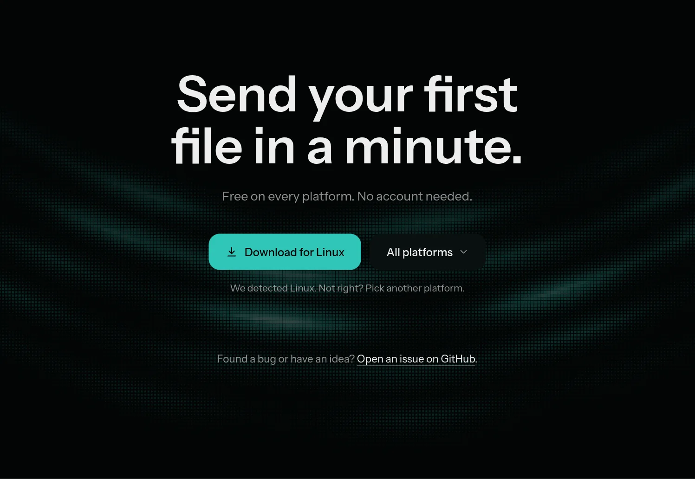
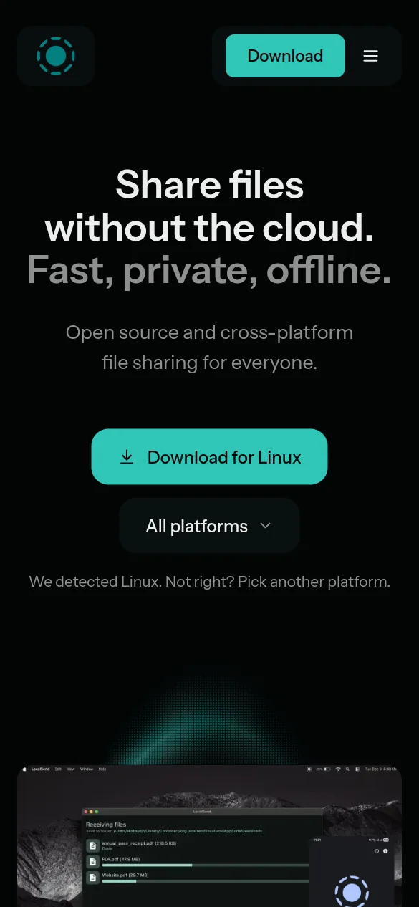

# LocalSend homepage redesign

An unofficial redesign concept of the [localsend.org](https://localsend.org) homepage, built as a study in restraint: calm type, one accent colour, and small animations that explain something instead of decorating.

It is not affiliated with the LocalSend project.

**Live demo: https://localsend-redesign.vercel.app**

<picture>
  <source media="(prefers-color-scheme: light)" srcset="docs/screenshots/light-hero.webp">
  
</picture>

## What is in it

**Hero.** A masked headline, a download button that detects your platform, and three keywords (Fast, private, offline) that tear apart on hover to reveal an icon. Behind the product shot, a WebGL dot field draws nested arches that lean toward the pointer.

**Features.** One ruled grid instead of four cards. Each cell carries a small scene that shows the claim: a bolt with speed streaks, an encrypted packet passing a checkpoint, platform logos in orbit, a crossed-out cloud.

<picture>
  <source media="(prefers-color-scheme: light)" srcset="docs/screenshots/light-features.webp">
  
</picture>

**How it works.** Three steps, each with a short loop that plays once when it scrolls into view.

<picture>
  <source media="(prefers-color-scheme: light)" srcset="docs/screenshots/light-how.webp">
  
</picture>

**Open source.** The real top contributors, pulled from the GitHub API and cached for a day. If the API is unavailable the section simply drops the avatar wall.

<picture>
  <source media="(prefers-color-scheme: light)" srcset="docs/screenshots/light-open-source.webp">
  
</picture>

**Community and FAQ.** The community channels read as one sentence. The FAQ is two short columns of native `<details>` that open one at a time.

<picture>
  <source media="(prefers-color-scheme: light)" srcset="docs/screenshots/light-community-faq.webp">
  
</picture>

**Closing.** The hero arches again, flipped, behind a final download call to action.

<picture>
  <source media="(prefers-color-scheme: light)" srcset="docs/screenshots/light-closing.webp">
  
</picture>

### On a phone



## Details worth knowing

- Dark and light themes from one set of CSS variables.
- `prefers-reduced-motion` is respected: loops stop and animated scenes show their final state.
- The page does not scroll sideways at 320px.
- Infinite ambient loops are CSS keyframes. One-shot animations use Motion and run once on scroll.
- Smooth scrolling with Lenis.

## Run it

```bash
npm install
npm run dev
```

Open http://localhost:3000. For a production build, `npm run build && npm start`.

Built with Next.js 16, React 19, Tailwind CSS 4, Motion and Lenis.

## Credits

- [LocalSend](https://github.com/localsend/localsend) by Tien Nam Do, licensed under Apache 2.0. The name, logo, copy and app screenshots belong to that project.
- The hero arch field is adapted from Originkit's "Predictive Arc 4".
- The orbiting platform logos follow Magic UI's Orbiting Circles, and the encryption scene follows Cult UI's Security Checkpoint.
- Platform logos come from [Simple Icons](https://simpleicons.org) (CC0).
